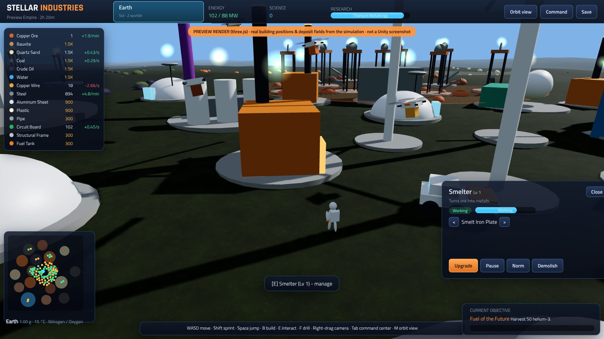
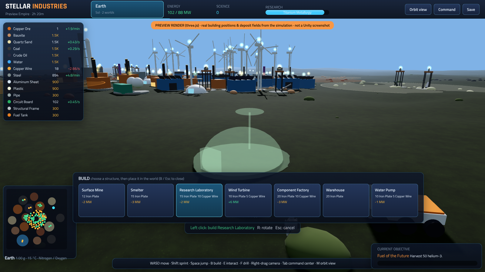
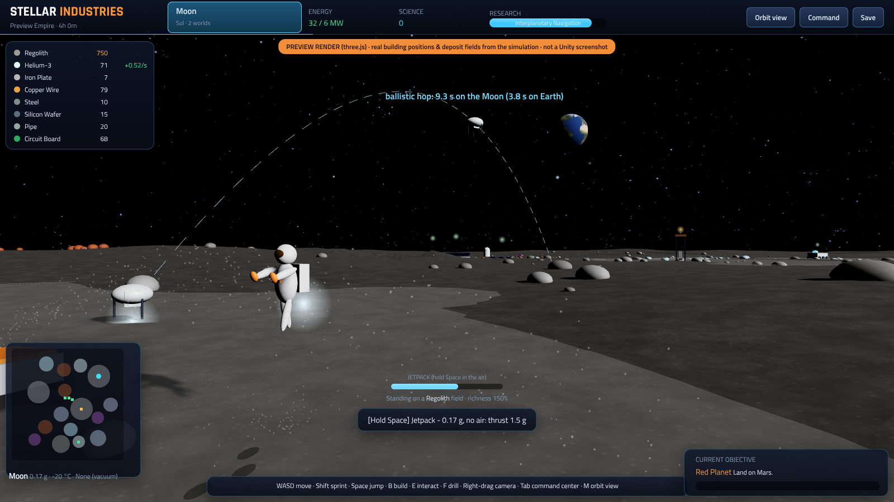
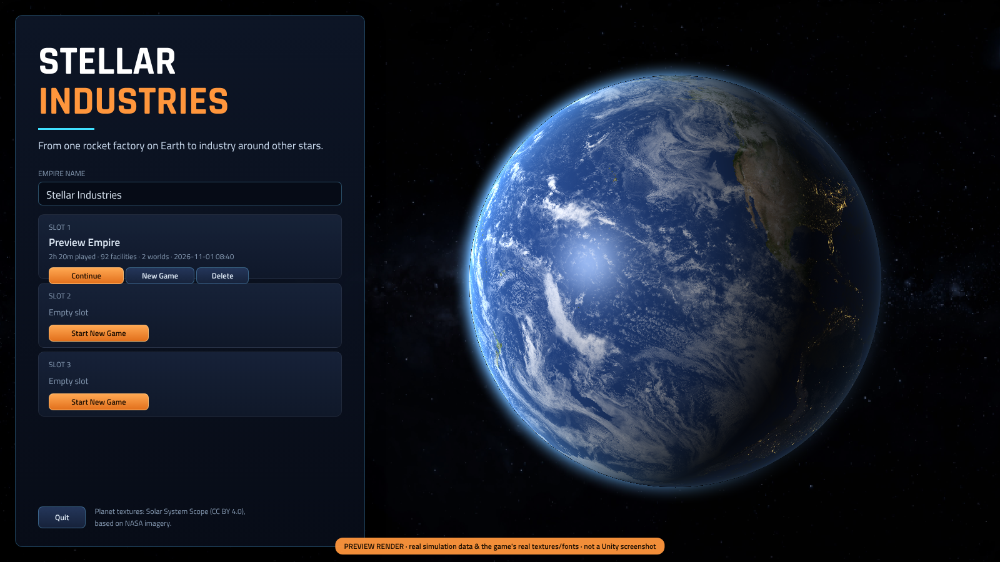
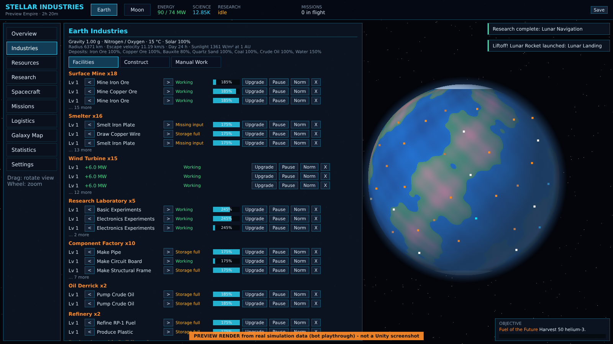
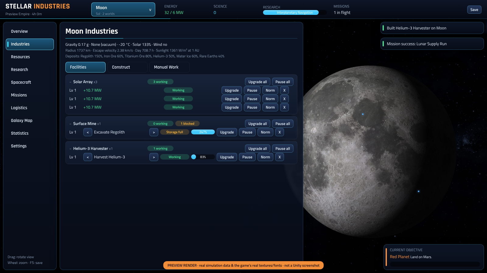
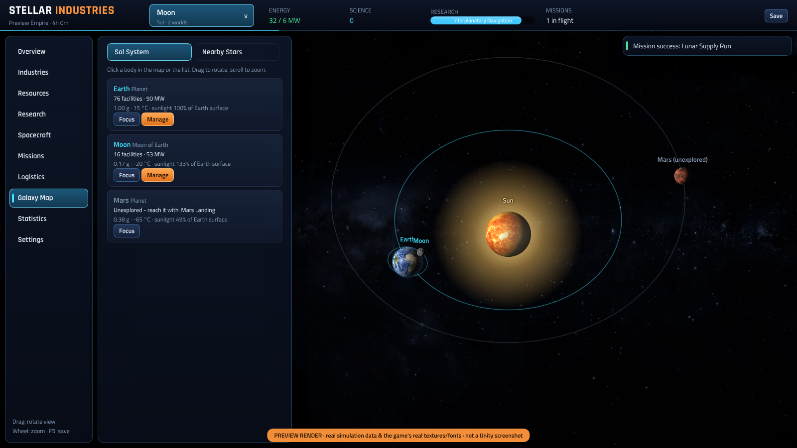
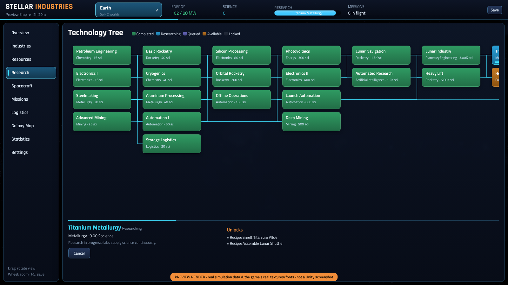
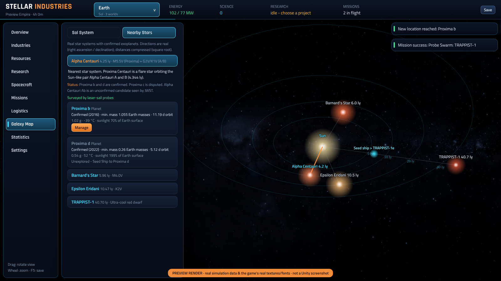
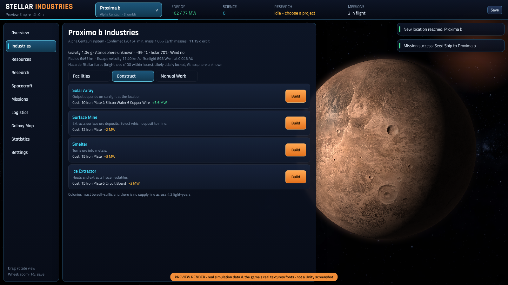

# Stellar Industries — Test Build (Milestone 1 + 2, first steps of 3)

An idle / incremental space-industry simulator for Unity. You start with one mine, one smelter and
one wind turbine on Earth, research rocketry, build your first rocket, reach orbit, land on the Moon,
build a lunar industry from local resources and — with enough research — head for Mars.

> **Status:** playable test build. The simulation core is compiled and covered by 36 automated
> tests (including a bot that plays from scratch to helium-3 mining on the Moon). The Unity layer
> compiles against UnityEngine 2021.3 LTS reference assemblies, but it has **not yet been run
> inside the Unity Editor** in this environment — please report anything that looks off.

## Preview

**Engineer mode (new):** you play an engineer on the surface and place every building yourself.

| Managing a smelter on Earth (delivery drones overhead) | Build mode: placing a research lab | Moon: jetpack, footprints, a hopper drone on its ballistic arc, Earth in the sky |
|---|---|---|
|  |  |  |

These three are three.js renders of the real simulation layout (building positions, deposit fields), not Unity screenshots.

Preview renders from **real simulation data** with the game's **real textures and fonts** — drawn outside Unity, so
**not Unity screenshots** (lighting/shading approximated, see `Tools/PreviewRender`).

| Main menu | Earth industries (2 h 20 min) |
|---|---|
|  |  |
| **Moon base (4 h)** | **Solar system map** |
|  |  |
| **Technology tree** | **Nearby stars (late-game scenario)** |
|  |  |
| **Colony on Proxima b (artist's impression)** | |
|  | |

## Quick start

**Option A — open this folder as a project**
1. Unity Hub → *Add project from disk* → select the `StellarIndustries` folder.
2. Choose an editor version (Unity **2021.3 LTS or newer**, incl. Unity 6). Let Unity import.
3. Press **Play** in any scene. The game bootstraps itself (`GameBootstrap`) — no scene setup needed.
   Optional: menu **Stellar Industries → Create Main Scene** creates `Scenes/Main.unity` and adds it to the build.

**Option B — copy into an existing project**
Copy `Assets/StellarIndustries` into the `Assets` folder of any 3D project (built-in render pipeline or URP).

## Controls (engineer mode)
| Key | Action |
|---|---|
| W A S D | walk (rover: drive / steer) |
| Shift / Space | sprint / jump — jump height follows real gravity (Moon ~6x higher than on Earth); on the Moon hold Space in the air for the jetpack |
| Right mouse drag · wheel | rotate / zoom camera |
| B | build palette → choose → place with left click, R rotates, Esc cancels |
| E | interact: manage building, open research terminal (labs), mission control (rocket pad), enter/leave rover |
| F (hold) | drill a deposit field by hand |
| Tab | command center (all management screens over the world) |
| M | switch between surface (engineer) and orbit view |

Mines and other extractors must stand **on a matching deposit field** (coloured rings in the terrain); buildings keep ~5 m walkways.

## How to play
| Step | What to do |
|---|---|
| 1 | **Industries → Manual Work**: gather ore by hand; **Construct**: build a copper mine, a second smelter (switch its recipe to *Draw Copper Wire* with `<` `>`), a research lab. |
| 2 | **Research**: start *Petroleum Engineering* and *Electronics I*, then *Basic Rocketry*. |
| 3 | Build oil derrick, refinery (fuel + plastic), component factories (pipes, circuits, frames, tanks, engines, guidance) and a **Rocket Assembly Building**. |
| 4 | **Missions**: launch the *Suborbital Test Flight* → science + objective. |
| 5 | Steel, aluminum, cryogenics → *Orbital Rocketry* → *Orbital Launch* unlocks the **Galaxy Map**. |
| 6 | *Lunar Navigation* → *Lunar Landing* unlocks the **Moon** with a starter kit. Build solar arrays and mines there (top bar switches locations). |
| 7 | *Lunar Industry*: ice, regolith processing, helium-3. *Launch Automation* → automated transport routes (**Logistics**). |

Hotkeys: `1`–`0` switch screens, `F5` saves. Drag in the 3D view to rotate, mouse wheel to zoom.
Settings → *Developer tools* offers game speed 1–100×, "simulate offline time" and cheats for testing.

## What is implemented
- **Data-driven economy**: 42 resources, 50 recipes, 18 building types, 28 technologies, 8 spacecraft (incl. laser-sail probe and fusion seed ship), 8 worlds in 5 real star systems (Earth, Moon, Mars + Proxima b/d, Barnard e, Epsilon Eridani b, TRAPPIST-1e), 16 missions, 15 achievements/objectives — all defined as data (`DefaultContent.cs`) and exportable to ScriptableObjects.
- **Production**: inputs, outputs, cycle times, storage limits, upgrades (levels), pause, priorities, recipe switching, power consumption.
- **Energy**: wind (only with atmosphere), coal (Earth only, burns fuel), solar (depends on location), He-3 fusion; shortages slow production proportionally.
- **Research tree** with prerequisites, material costs, queue, cancel/refund, automated research, modifiers (production, extraction, storage, offline, mission speed, reliability).
- **Rockets & missions**: rockets are produced items; launches consume vehicle + fuel + cargo; success chance, travel time, first-time rewards, location unlocks; reusable rockets return.
- **Logistics**: automated, repeating transport routes between Earth and Moon/Mars.
- **Idle/offline**: offline progression with cap (8 h base) and efficiency (50 % base), both upgradeable; clock-rollback protection; summary screen.
- **Save system**: 3 slots, autosave, versioned format with checksum, atomic writes, rolling backup, automatic repair of unknown/invalid data, migration hook.
- **Interstellar (Era 6, first step)**: real nearby star systems with confirmed exoplanets, laser-sail probe surveys, Daedalus-style fusion seed ships from the lunar shipyard, self-sufficient colonies, 3D star map at real sky positions.
- **HD visuals**: real planet surfaces (8K Earth with city lights and a separate cloud layer, 4K Moon and Mars), atmospheric glow, real axial tilts (NASA), Milky Way sky, textured Sun with glow, glowing stars; exoplanets as clearly labelled artist's impressions.
- **Modern UI**: rounded glass panels, gradient buttons, glossy progress bars, status pills, collapsible facility groups with bulk actions, Rajdhani/Titillium Web typefaces.
- **3D presentation**: planets, installations visible on the surface (status blinking), launch animations with trails (pooled), solar-system map with orbits and missions in flight.
- **Scientific realism** (see `Docs/SCIENCE.md`, sources: NASA fact sheets, Wikipedia *Delta-v budget*): staged rocket equation, real Δv budgets, cargo mass limits, Mars launch windows (synodic period), inverse-square solar power, air separation for LOX, flight-heritage reliability, real planet data in the UI.
- **UI**: main menu with slots, 10 screens, progressive unlocking of screens, tooltips, notifications, objectives.

## Performance
Four graphics presets with auto-detection, adaptive quality and a battery saver; LOD, instancing, static batching and a
garbage-free simulation (12 bytes per tick even with 5,000 buildings). Details and measurements: `Docs/PERFORMANCE.md`.

## Tests & compile checks (no Unity required)
```bash
Tools/HeadlessTests/run.sh                       # builds core as netstandard2.1/C# 9 and runs all tests
dotnet run --project Tools/HeadlessTests/Runner/HeadlessTests.csproj -- --bot-trace   # balancing trace of the bot
dotnet build Tools/UnityCompileCheck/Runtime/Runtime.csproj               # Unity layer vs UnityEngine 2021.3
dotnet build Tools/UnityCompileCheck/EditorAndTests/EditorAndTests.csproj # editor scripts + NUnit wrapper
```
Inside Unity: *Window → General → Test Runner → EditMode* runs the same suite.

## Documentation
- `Docs/ARCHITECTURE.md` — systems, data flow, design decisions
- `Docs/ADDING_CONTENT.md` — add planets, resources, buildings, recipes, rockets, missions without code
- `Docs/ROADMAP.md` — milestone status and next steps
- `Docs/PERFORMANCE.md` — measurements, presets and optimisations
- `Docs/SCIENCE.md` — physics model, real data, sources and deliberate simplifications
